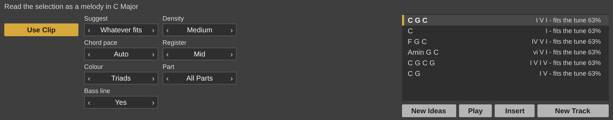
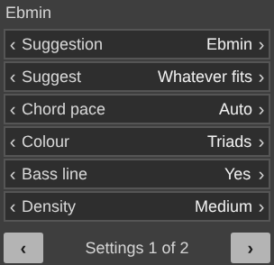

# Midi Suggester for Ableton Live

A Max for Live MIDI effect. The suggestions come from `reascripts/ms_read.lua`, `ms_harmony.lua`, `ms_melody.lua` and `ms_theory.lua`, the same files the REAPER script runs, unchanged.

**Its colours are Live's**, after Ableton Live 8's default theme: neutral greys and one amber for what is on, so it sits beside Live's own devices. The REAPER version keeps the house scheme's yellow.

## Installing

Needs **Live 12.1 or later with Max for Live** (Live Suite, or Standard with
the add-on): the device runs on Max 9's JavaScript engine (`[v8ui]`).

1. Copy `Midi Suggester.amxd`, `MidiSuggester.js` and `MidiSuggester.maxpat` into one folder, for
   example `Music/Ableton/User Library/Presets/MIDI Effects/Max MIDI Effect/`. The `.amxd` finds
   `MidiSuggester.js` beside it.
2. Drag `Midi Suggester.amxd` onto a MIDI track, in front of an instrument.
3. Optional: open it in the Max editor and click **Freeze Device**, then save.
   The device then carries the script inside it and can be moved on its own.

## Using it

| | |
| --- | --- |
| **Use Clip** | Takes the clip open in Detail View: its selected notes if any are selected (from the bar they start in), otherwise every note in its loop. The key is heard in the music, so there is no key to set. |
| The middle | The engine's settings, only the ones that apply. Click the right of a value for the next, the left for the one before, or drag up and down. **Part** appears when a result has several parts: all of them, or one. |
| The list | Suggestions for the clip: chord progressions under a melody, melodies over chords. Click one to hear it on the track's instrument. |
| **New Ideas** | Asks again, with a new number. |
| **Play** | Plays the chosen suggestion with the clip it was made for, or stops it. |
| **Insert** | Puts the chosen suggestion where the button beside it says: **New Track** (a new MIDI track beside this one, in the selected scene - the first choice, so the suggestion goes with the music rather than over it), **New Clip**, **Arrangement** (at the insert marker; Live 12.2 or later) or **This Clip**. One undo step. |

The settings and the key are saved with the Live set.

## In the clip view's Transform panel

`ableton/tool/` has Midi Suggester as a **MIDI Tool** too: Live 12 lists it under **Transform** in a MIDI clip's view, beside Live's own. It needs Live 12.1 or later with Max for Live, as the device does.

1. Copy `Midi Suggester.amxd` and `MidiSuggesterTool.js` from `ableton/tool/` into one folder of your User Library, for example `User Library/MIDI Tools/Max Transformations/`, keeping the `.js` beside the `.amxd`.
2. Open a MIDI clip, open **Transform** in the clip view, and choose Midi Suggester.
3. Select the melody (or the chords) to go with, set the panel, and click **Transform**.

| | |
| --- | --- |
| **Suggestion** | One of the suggestions, best first. |
| The rest | The engine's settings, as on the device, six to a page: click the right of a line for the next value, the left for the one before, or drag up and down. **‹** and **›** turn the page. A change writes again at once while Live's **Auto** is on; otherwise click **Transform** again. |

The selected notes stay exactly as they are and the suggestion is added beside them: chords under a melody, or a melody over chords.

`python3 ableton/kit/build.py ableton/tool/tool.json` builds it from the same engine, adapter and kit as the device (`ableton/kit/miditool.js`), and `node --test ableton/tests/test_tool.js` runs it on a pretend Max: the file is a MIDI Tool of its kind, wired from `live.miditool.in` to `live.miditool.out`; what it writes stays inside the time selection; the same apply gives the same notes; a changed setting asks Live to apply again; the settings are kept with the set. `node ableton/tool/window.js` redraws its picture.

## How it is built

`ableton/device.json` describes the device; `python3 ableton/kit/build.py
ableton/device.json` writes the `.amxd`, the `.maxpat` and the script bundle
`MidiSuggester.js`. The bundle is Middaw's Lua 5.4 runtime, the engine, the Noterator adapter (`ableton/adapters/`) and the shared window (`ableton/kit/generator.js`). See `ableton/kit/VENDORED.md`.

`node --test ableton/tests/test_device.js` runs the device on a pretend Max and a pretend Live set: every setting stepped through, hearing a result (every note started is stopped), each way of inserting, a full track refused, and saving and restoring with the set. Its own tests check a tune gets chords and chords get a single-line melody, and that a suggestion goes on its own track and is heard with the clip. `node ableton/window.js` redraws the picture above from the device's own drawing code (it needs Playwright's Chromium).

## Limits

- The MIDI Tool has not been opened in Live either. Its file type is the one Ableton's own `maxdevtools` names; how Live hands it the notes and the context (`live.miditool.in`) comes from a working open-source tool, not from Cycling '74's reference, which could not be reached from where this was built.
- **It has not been opened in Live yet.** It is tested in Node against a stand-in for Max and the Live Object Model; nothing has run in Max. If the `.amxd` will not open, open `MidiSuggester.maxpat` in Max and save it as a device.
- Results are heard on whatever instrument is after the device, a few milliseconds late at worst: Max's JavaScript runs off the audio thread.
- Parts put on new tracks have no instrument yet: a device cannot load one.
- The REAPER script copies the clip's instrument to the new track. A device cannot, so the new track has none until you add one; until then Play is the way to hear it.
